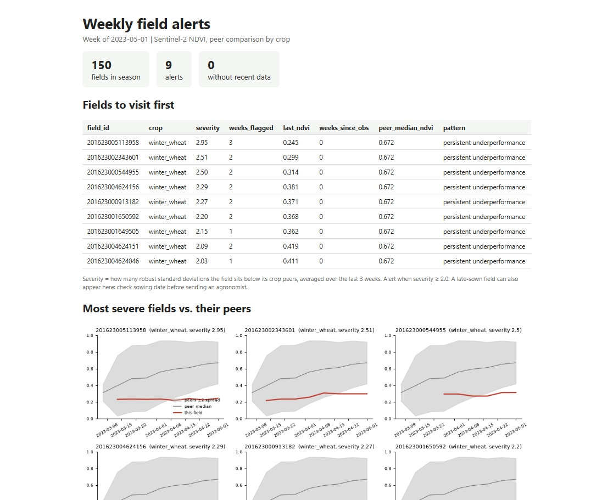
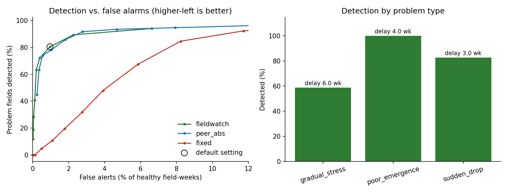

# fieldwatch: weekly field alerts from satellite NDVI

[](https://github.com/Biokatzen/fieldwatch/actions)

**Problem.** A seed or crop company monitors hundreds or thousands of fields, but agronomists can only
visit a few each week. Which ones should they visit first?

**Solution.** Every week, `fieldwatch` compares each field with its *peers* (same crop, same week) using
Sentinel-2 NDVI and flags fields that stay well below them for several weeks. It needs **no yield
labels**, and the output is a ranked list plus a one-page report that can be sent as-is.



*Weekly report on real data (Kansas winter wheat). [Synthetic-data example as HTML](docs/example_report.html): download and open in a browser.*

## How it works
1. **Weekly composite:** max-value composite per week (suppresses residual clouds), then a trailing
   median that needs at least 2 real observations. Gaps are reported as "no data", never invented.
2. **Peer comparison:** robust z-score against the median and MAD of the same crop that week. This
   removes the normal seasonal curve and weather effects.
3. **Persistence rule:** alert if the mean z over the last 3 weeks is <= -2. One cloudy week does not trigger an alert.
4. **Monitoring window per crop**, so harvest and early-season differences don't create alerts.
5. **Report:** ranked table (severity, weeks flagged, last NDVI, pattern), field-vs-peers charts, map.

Everything is **causal**: week *t* uses only data up to week *t*, and a unit test enforces it.

## Backtest results
10 simulated seasons x 120 fields, **169 injected problems** with known start dates (sudden drop, gradual stress,
poor emergence). Seeds used for the final numbers were never used while developing the method.

| | fieldwatch (default) |
|---|---|
| Problem fields detected | **80%** |
| False alerts | **1.0%** of healthy field-weeks (about 1 per 100 fields per week) |
| Median delay after problem onset | 4 weeks |

For a company with 1,000 fields, that is roughly 10 false alerts per week to triage next to the real ones.

**At the same false-alarm rate** (fair comparison of detectors):

| Method | Problems detected |
|---|---|
| fieldwatch (robust peer z-score) | 80% |
| Simple peer rule (NDVI > 0.10 below crop median) | 78% |
| Fixed NDVI threshold (typical dashboard) | 9% |



**By problem type:** sudden drop 83% (median delay 3 weeks), poor emergence 100% (4 weeks),
gradual stress 59% (6 weeks; it develops slowly, so it is also the hardest).

### What I learned (honest reading)
- **Peer comparison is what matters.** A fixed NDVI threshold is nearly useless because NDVI depends on crop and season.
- **The robust z-score gave no meaningful accuracy gain** over a simple margin rule (80% vs 78%, within noise). Its advantage
  is practical: a threshold in standard deviations is easier to explain and reuse across crops.
- **Clouds were the main failure mode.** Inspecting the plots showed that one hazy pixel after a cloud gap can
  imitate a real drop. I fixed this (minimum 2 observations, conservative median) and added unit tests.
- **Detection takes weeks by design:** persistence trades speed for fewer false alarms. A dedicated sudden-change rule could cut the delay.

## Limitations
- **Backtest data are simulated** (`make_demo_data.py`, with realistic phenology, cloud gaps and undetected haze).
  Absolute numbers on real fields will differ and the method-vs-method ranking could too.
  *First thing to do with real data: have an agronomist check the top 20 alerts and measure the hit rate.*
- Late-sown fields can look like underperformers, since peers are defined by crop only. Adding sowing date, variety or
  region to the peer definition is the natural next step.
- Monitoring windows are hand-set per crop; harvest/mowing detection is not implemented.
- `fetch_sentinel2_gee.py` and `prepare_fields_csb.py` ran successfully on real data (Kansas 2023). The thumbnail step of `validate_alerts.py` has not been run yet.

## Use it
```bash
pip install -r requirements.txt
python make_demo_data.py                 # synthetic fields + injected problems -> data/demo/
python run_weekly_report.py --fields data/demo/fields.csv --ndvi data/demo/ndvi_timeseries.csv \
       --week 2025-07-14 --out reports   # alerts CSV + HTML report
python evaluate.py                       # backtest + figures in docs/
pytest                                   # 9 tests
```

**With your own data**, provide two CSVs (or generate them from Sentinel-2 with `fetch_sentinel2_gee.py`):
`fields.csv` (`field_id, crop[, lon, lat]`) and `ndvi_timeseries.csv` (`field_id, date, ndvi`, cloud-masked).

## Real-data run: winter wheat, Kansas (USDA CSB + Sentinel-2)
Public, free data: [USDA Crop Sequence Boundaries](https://www.nass.usda.gov/Research_and_Science/Crop-Sequence-Boundaries/)
(algorithmic field polygons with crop history, public domain) and Sentinel-2 via Earth Engine.
Kansas harvest usually starts in early to mid June, so the monitoring window is shortened to 1 Apr - 31 May
(check NASS weekly *Crop Progress* for your season) to avoid reading harvested fields as failures.

```bash
pip install earthengine-api geopandas && earthengine authenticate
python prepare_fields_csb.py --project MY_PROJECT --counties Saline --year 2023 --n 150 --out data/ks
python fetch_sentinel2_gee.py --fields data/ks/fields.gpkg --start 2023-03-01 --end 2023-06-15 \
       --project MY_PROJECT --out data/ks
for w in 2023-04-17 2023-05-01 2023-05-15 2023-05-29; do
  python run_weekly_report.py --fields data/ks/fields.csv --ndvi data/ks/ndvi_timeseries.csv \
         --window winter_wheat=04-01:05-31 --week $w --out reports/ks
done
```
### Results on real data: winter wheat, Kansas, 2023
150 winter-wheat fields (USDA Crop Sequence Boundaries, Saline County), Sentinel-2 NDVI from Earth Engine,
monitoring window 1 Apr - 31 May.

| Week | Alerts (out of 150 fields) |
|---|---|
| 2023-04-17 | 1 |
| 2023-05-01 | 9 |
| 2023-05-15 | 7 |
| 2023-05-29 | 5 |

Alerts are a prioritised list of fields worth inspecting, **not** a diagnosis. Whether they correspond to
real problems is checked with the blind validation below. CSB polygons are estimates and the crop labels
come from satellite classification, not farm records.

**Blind validation:** pending. Replace this line with the real counts, for example
"X of Y alerted fields rated as problem vs. X of Y control fields".

## Files
| File | Purpose |
|---|---|
| `fieldwatch.py` | core logic: weekly composite, peer z-scores, alert rules |
| `run_weekly_report.py` | weekly CSV + HTML report |
| `evaluate.py` | backtest against baselines |
| `make_demo_data.py` | synthetic dataset with known problems |
| `fetch_sentinel2_gee.py` | real Sentinel-2 NDVI download (ran on real data) |
| `prepare_fields_csb.py` | select winter-wheat fields from USDA Crop Sequence Boundaries (ran on real data) |
| `tests/` | 9 unit tests, including a no-future-data test |

MIT License
